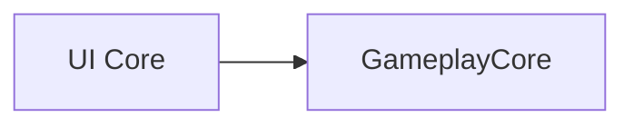

# Sistemas

Cada sistema tem sua própria pasta (`kebab-case`):

```
02-sistemas/
└── <nome-do-sistema>/
    ├── README.md     # visão do sistema (modelo _modelos/SISTEMA.md), obrigatório
    ├── diario.md     # diário de desenvolvimento (modelo _modelos/DIARIO.md), obrigatório
    ├── <detalhe>.md  # opcional
    └── assets/       # opcional, só .png/.svg
```

## Quadro de status

> Atualizado pelas IAs a cada envio (REGRAS 10.2). Fases: planejado · em-desenvolvimento · em-teste · em-producao.

| Sistema | Fase | Responsável | Repositório | Última atualização |
|---|---|---|---|---|
| [GameplayCore](gameplay-core/README.md) | em-desenvolvimento | mercurius17 | [mercurius17/AetheriusGameplayCore](https://github.com/mercurius17/AetheriusGameplayCore) | 2026-11-14 |
| [UI Core](ui-core/README.md) | em-desenvolvimento | mercurius17 | [mercurius17/AetheriusUI_Core](https://github.com/mercurius17/AetheriusUI_Core) | 2026-11-14 |

## Mapa de dependências


