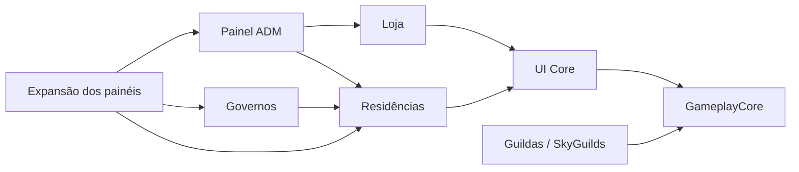

# Sistemas

Cada sistema tem sua própria pasta (`kebab-case`):

```
02-sistemas/
└── <nome-do-sistema>/
    ├── README.md     # visão do sistema (modelo _modelos/SISTEMA.md), obrigatório
    ├── diario.md     # diário de desenvolvimento (modelo _modelos/DIARIO.md), obrigatório
    ├── <detalhe>.md  # opcional
    └── assets/       # opcional, só .png/.svg
```

## Quadro de status

> Atualizado pelas IAs a cada envio (REGRAS 10.2). Fases: planejado · em-desenvolvimento · em-teste · em-producao.

| Sistema | Fase | Responsável | Repositório | Última atualização |
|---|---|---|---|---|
| [GameplayCore](gameplay-core/README.md) | em-desenvolvimento | mercurius17, kdu | [pablo-rodrigues1/AetheriusGameplayCore](https://github.com/pablo-rodrigues1/AetheriusGameplayCore) | 2026-11-14 |
| [UI Core](ui-core/README.md) | em-desenvolvimento | mercurius17 | [pablo-rodrigues1/AetheriusUI_Core](https://github.com/pablo-rodrigues1/AetheriusUI_Core) | 2026-11-14 |
| [Lobisomem sincronizado](lobisomem/README.md) | em-teste | kdu | pacote separado (patches sobre aetherius-server v0.38) | 2026-11-14 |
| [Olhar sincronizado](olhar-sincronizado/README.md) | em-teste | kdu | kit de teste local (gamemode/olhar-service.js) | 2026-11-14 |
| [Ocarina (só música)](ocarina/README.md) | em-teste | kdu | pacote separado (mod + patch sobre aetherius-server v0.38) | 2026-11-14 |
| [Túnica do Herói](tunica-do-heroi/README.md) | em-teste | kdu | pacote separado (mod com plugin próprio) | 2026-11-14 |
| [Sincronização de NPCs](sincronizacao-de-npcs/README.md) | em-desenvolvimento | kdu | aetherius-client / aetherius-server | 2026-11-14 |
| [Loja e apoiadores](loja/README.md) | em-desenvolvimento | A confirmar | [aetherius-loja](https://github.com/eksmurf/aetherius-loja) | 2026-11-14 |
| [Residências e IPTU](residencias/README.md) | em-desenvolvimento | A confirmar | [aetherius-residencias](https://github.com/eksmurf/aetherius-residencias) | 2026-11-14 |
| [Painel administrativo](painel-adm/README.md) | em-teste | A confirmar | [painel-oficial](https://github.com/eksmurf/painel-oficial) | 2026-11-14 |
| [Governos, Jarl e castelos](governos/README.md) | em-desenvolvimento | A confirmar | [aetherius-painel-jarl](https://github.com/eksmurf/aetherius-painel-jarl) | 2026-11-14 |
| [Expansão dos painéis](expansao-dos-paineis/README.md) | planejado | A confirmar | Planejamento dos painéis | 2026-11-14 |
| [Guildas (SkyGuilds)](guildas/README.md) | em-desenvolvimento | Melekyy | Projeto local; URL do código a informar | 2026-11-14 |

Conciliação documental de feitiços concluída em 14/11/2026: 164 registros na planilha e nas fichas; [divergências dos JSONs](gameplay-core/feiticos-por-classe.md) permanecem pendentes de implementação. GameplayCore continua em desenvolvimento; ver [diário](gameplay-core/diario.md).

## Mapa de dependências


