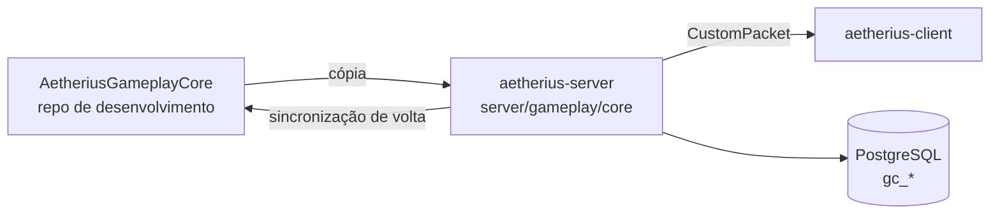

# AetheriusGameplayCore

## Resumo
Monorepo TypeScript com a lógica autoritativa de gameplay do Aetherius (classes, perks, atributos, XP/nível, combate, inimigos, durabilidade), persistida em PostgreSQL. Roda dentro do servidor oficial como cópia em `server/gameplay/core`; este repositório é a fonte de desenvolvimento e recebe de volta as mudanças feitas no servidor.

## Onde está o código
- Repositório: https://github.com/pablo-rodrigues1/AetheriusGameplayCore (branch `main`)
- Cópia em produção: `AetheriusRP/aetherius-server`, pasta `server/gameplay/core` (o `PROVENANCE.md` de lá registra o commit de origem e as alterações locais)
- Pontos de entrada:
  - `runtime/src/index.ts`: composição do runtime, modos por domínio (`off`/`canary`/`active`) e entrega ao cliente
  - `modules/<sistema>/`: um módulo por sistema (lista abaixo)
  - `database/migrations/NNNN_*.sql`: migrations PostgreSQL, com hash conferido no boot
  - `catalog/*.json`: catálogos assinados gerados a partir dos exports do houseCARL
  - `integrations/INSTALL.md`: guia de integração ao servidor oficial (DOC-2)

## Escopo
- Inclui: classes e progressão (`class-progression-system`), XP/nível/fadiga (`leveling-system`), combate e dano (`damage-system`), composição de grants por origem (`actor-state-system`), inimigos e dungeons (`enemy-system`), durabilidade (`durability-system`), raças e pedras (`race-system`, `standing-stone-system`), documentação de profissões/coleta/artesanato/refino.
- Não inclui: código vivo do host e do cliente (fica em `AetheriusRP/aetherius-server` e `aetherius-client`); o módulo de execução de profissões do servidor (`server/gameplay/professions`); a interface (ver [UI Core](../ui-core/README.md)).

## Funcionamento

- O servidor é dono das escritas; o cliente só recebe projeções (perks, skills de classe) e devolve ACK.
- Cada domínio tem modo próprio; em `canary` só personagens da lista de canário recebem a mudança.
- Comandos duráveis passam por `executeCommand` (idempotente por `requestId`, serializado por personagem com lock).

## Parâmetros e fórmulas
| Parâmetro | Valor | Descrição |
|---|---|---|
| Nível máximo de classe | 40 | `class.level` aceita 1–40 |
| Pontos de atributo | `15 × (nível − 1)` | 585 no nível 40; gastos em múltiplos de 5 |
| XP total ao fixar nível | soma de `xpRequiredFor(l)` para `l < nível` | usado por `setProgressLevel`; XP do nível atual zera |
| Chave de personagem | `profile:N` ou `character:<uuid v1–8>` | UUID usa namespace de lock próprio (`gc:character-uuid:`) |

## Dependências
| Depende de | Por quê |
|---|---|
| `AetheriusRP/aetherius-server` | host que carrega o runtime, Host APIs, addon nativo de combate |
| `AetheriusRP/aetherius-client` | recebe projeções de perks e skills de classe |
| houseCARL (exports da load order) | gera os catálogos assinados e os fixtures dos testes |
| PostgreSQL | persistência durável (`gc_*`) |

## Decisões relacionadas
- [ADR-0002](../../03-decisoes/ADR-0002-sincronizacao-dos-cores-com-os-repositorios-oficiais.md): como as mudanças do servidor voltam para este repositório.

## Frente de dano no servidor
Correções da cadeia de dano no addon nativo do `aetherius-server`, ligadas por chave: ver [Correções de dano no servidor](correcoes-de-dano.md) (kdu).

## Feitiços das classes

A [lista completa por classe, escola e tier](feiticos-por-classe.md) transcreve os 164 registros de Classes e documenta a sincronização de Classes - Progressão (B23:F40), de 14/11/2026. Registra também as divergências do código: `authorizedSpells` tem 128 entradas (127 associações únicas) e `allSpellsList` tem os 164 nomes, com seis tiers diferentes. Trata-se de conciliação documental/design; não modifica JSONs, catálogos ou runtime, conforme o ADR-0003.

## Frente de conjuração

Melekyy iniciou, com confirmação explícita do dev em 14/11/2026, uma frente limitada à conjuração: investigar o desaparecimento no cliente da v0.38, adaptar o acompanhamento normal e entre instâncias usado no privado e avaliar duas criaturas simultâneas. A versão anterior e o pacote acumulado de correções devem ser preservados. O encaixe no privado também foi solicitado. Esta entrada registra o início; não declara correção nem implantação concluída.

## Diário
Ver [`diario.md`](diario.md).

## Pendências conhecidas
- Catálogos ainda assinados para os masters da máquina de desenvolvimento, não para os do servidor oficial (v0.37.0).
- Migration `0013` em LF aqui e CRLF no servidor: o hash diverge entre as duas origens.
- A cópia do servidor ainda não tem a DS-7 (`hitSeq`) nem a correção de testes `41e8334`.
- 26 testes dependem de exports do houseCARL e do `dist` do servidor; sem eles falham por ambiente.
