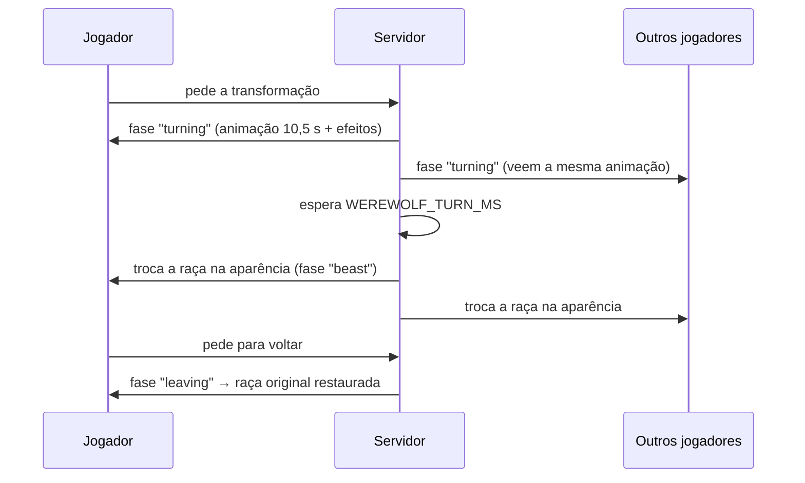

# Lobisomem sincronizado

## Resumo
Transformação em lobisomem que todos os jogadores veem, com a forma controlada pelo servidor. A fera usa a raça do mod Manbeast, 50% maior, com animação de transformação própria (10,5 s, pés plantados), sangue e tremor na câmera. Armas de prata causam dano extra na fera.

## Onde está o código
- Entregue como pacote **separado** do pacotão de dano ("AETHERIUS - LOBISOMEM 14-11"): patches de servidor, cliente e perfis, mais o plugin `AETHERIUS - LOBISOMEM.esp` (ESL) e o mod de animação `AETHERIUS - LOBISOMEM TRANSFORMACAO`.
- Servidor: `gamemode/werewolf-service.js` (dono da forma) e `gamemode/werewolf/client.js` (efeitos no cliente).
- Cliente: `remoteServer.onUpdateAppearanceMessage` → troca de raça de criatura (`Actor.setRace`).
- Registro persistente: `data/aetherius-werewolf.json`.

## Escopo
- Inclui: entrar/sair da forma, sincronização para os outros jogadores, nome escondido na forma de fera, dano extra de prata, efeitos visuais e sonoros da transformação, restauração da forma depois de reiniciar o servidor.
- Não inclui: como o jogador vira lobisomem (doença, quest, compra); poderes e perks da fera; balanceamento de atributos da fera.

## Funcionamento

- O servidor é o dono da forma: a propriedade `aetheriusBeast` guarda a fase (`turning`/`beast`/`leaving`) e uma sequência; a raça original fica em `aetheriusBeastOriginal`.
- Na forma de fera, a aparência leva o nome "Lobisomem"; a plaquinha do SkySocial mostra esse nome só para quem está perto (até 4096 unidades). Não há aviso geral.
- Prata: acerto com arma de prata (keywords de material prata) ou munição de prata vestida aplica o multiplicador extra. O extra nunca mata sozinho (piso de 1% de vida) e não conta coronhada.

## Parâmetros e fórmulas
| Parâmetro | Valor | Descrição |
|---|---|---|
| `WEREWOLF_ANIMATION` | `aeth` (padrão) ou `vanilla` | animação própria ou a do jogo |
| `WEREWOLF_TURN_MS` | 10500 (`aeth`) / 5500 (`vanilla`) | tempo até a troca de raça |
| `WEREWOLF_SILVER_MULT` | 1,5 | dano de prata na fera (+50%) |
| Altura da fera | 1,69 (macho) / 1,50 (fêmea) | raça do Manbeast ~50% maior |
| Alcance do nome "Lobisomem" | 4096 unidades | distância da plaquinha |

## Dependências
| Depende de | Por quê |
|---|---|
| Mod Manbeast | raça da fera |
| Pandora (comportamentos gerados pelo MO2) | registra a animação nova |
| `aetherius-server` v0.38 | base dos patches |

## Decisões relacionadas
- Pacote separado do pacotão de dano porque o pacotão já tinha sido enviado (pedido do Kdu, 13/11).

## Diário
Ver [`diario.md`](diario.md).

## Pendências conhecidas
- Versão mesclada (animação v4 + sangue na tela + gore) ainda não vista em jogo.
- Teste com 2 jogadores.
- Interação com o script original do Manbeast.
- Câmera pulando no momento da troca; estouros no corpo não conferidos (sala escura).
