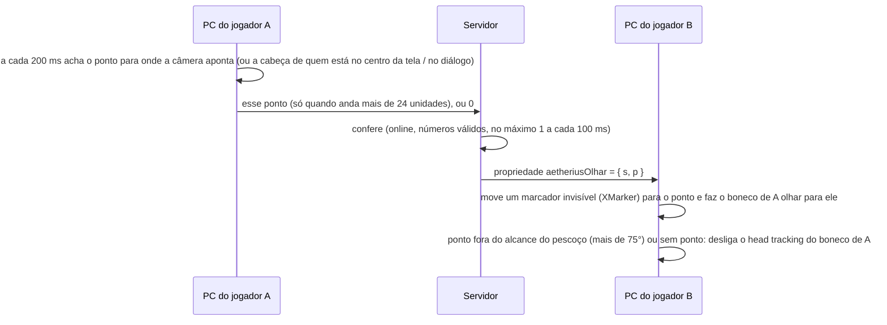

# Olhar sincronizado (head tracking)

## Resumo
Faz todo mundo ver, sem corte, para onde cada jogador está olhando: o boneco de cada um vira a cabeça para o ponto para onde a câmera daquele jogador aponta, inclusive para o vazio. Antes, a IA do jogo virava a cabeça de todos os jogadores remotos para quem chegasse perto ("todo mundo fica te encarando"). O head tracking do True Directional Movement só funciona no próprio PC, então ninguém via para onde o outro olhava.

## Onde está o código
- Servidor: `gamemode/olhar-service.js`, instalado em `phase0-basic.js` logo depois do lobisomem.
- Cliente (trechos enviados pelo servidor): `gamemode/olhar/client.js`.
- Testes: `gamemode/olhar/tests/olhar.test.cjs`.
- Código próprio, só em JavaScript do SkyrimPlatform, sem DLL nova.

## Escopo
- Inclui: todos os jogadores. Direção da câmera (qualquer ponto), pessoa no centro da tela, alvo de diálogo, desligar o "encarar" quando não há ponto.
- Não inclui: NPCs do servidor, que continuam com o olhar normal do Skyrim.

## Funcionamento

- Ponto da câmera: o PC projeta na tela pontos numa esfera de 800 unidades em volta da cabeça (busca grossa de 10° e fina de 2°) e fica com o que cai no centro.
- O alvo vai como posição, não como id: cada PC dá ids diferentes para o mesmo jogador. Se A olha para B, no PC de B o boneco de A olha para a cabeça de B.
- A cabeça vira suave pela interpolação do próprio jogo; o marcador só é movido quando o ponto anda mais de 8 unidades. Marcadores de bonecos que sumiram são apagados a cada 2 s.
- O PC de quem recebe reaplica a cada 2 s, porque a IA pode religar o head tracking sozinha.
- Quem acaba de entrar começa "olhando para a frente".

## Parâmetros e fórmulas
| Parâmetro | Valor | Descrição |
|---|---|---|
| `OLHAR_SINCRONIZADO` | ligado (padrão) / `false` | desliga o sistema inteiro |
| Distância do ponto da câmera | 800 unidades da cabeça | |
| Pessoa no centro | até 2000 unidades, raio 0,06 da tela | vence o ponto da câmera |
| Limite do pescoço | 75° da frente do corpo | além disso olha para a frente |
| Envio | no máximo a cada 200 ms, quando o ponto anda mais de 24 unidades; reforço a cada 5 s | |
| Limite no servidor | 1 evento a cada 100 ms por jogador | |

## Dependências
| Depende de | Por quê |
|---|---|
| SkyrimPlatform (`worldPointToScreenPoint`, `PlaceAtMe`, `SetLookAt`, `SetHeadTracking`) | achar o ponto, criar o marcador e virar a cabeça |

## Pendências conhecidas
- Teste em jogo com 2 jogadores: girar a câmera devagar e ver se a cabeça do outro acompanha suave. Se olhar para o lado oposto, ajustar a leitura de pontos atrás da câmera.
- Conferir convivência com o head tracking do TDM no próprio PC: o sistema não mexe no jogador local, então não deve conflitar.
- Aplicar no oficial (pacote separado entregue ao Mercurius em 14/11).
