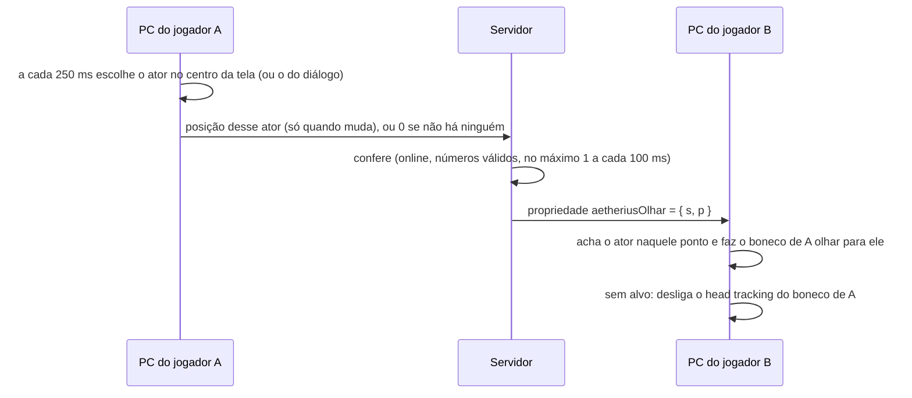

# Olhar sincronizado (head tracking)

## Resumo
Faz o boneco de cada jogador olhar para onde o jogador de verdade está mirando. Antes, a IA do jogo virava a cabeça de todos os jogadores remotos para quem chegasse perto ("todo mundo fica te encarando"). O head tracking do True Directional Movement só funciona no próprio PC, então ninguém via para onde o outro olhava.

## Onde está o código
- Servidor: `gamemode/olhar-service.js`, instalado em `phase0-basic.js` logo depois do lobisomem.
- Cliente (trechos enviados pelo servidor): `gamemode/olhar/client.js`.
- Testes: `gamemode/olhar/tests/olhar.test.cjs`.
- Código próprio, só em JavaScript do SkyrimPlatform, sem DLL nova.

## Escopo
- Inclui: todos os jogadores. Mira, alvo de diálogo, desligar o "encarar" quando não há alvo.
- Não inclui: NPCs do servidor, que continuam com o olhar normal do Skyrim; olhar para um ponto vazio (o jogo só deixa olhar para um ator).

## Funcionamento

- O alvo vai como posição, não como id: cada PC dá ids diferentes para o mesmo jogador. Quem recebe procura o ator mais perto daquele ponto (até 128 unidades).
- Se A olha para B, no PC de B o boneco de A olha para o próprio B.
- O PC de quem recebe reaplica a cada 2 s, porque a IA pode religar o head tracking sozinha.
- Quem acaba de entrar começa "olhando para a frente".

## Parâmetros e fórmulas
| Parâmetro | Valor | Descrição |
|---|---|---|
| `OLHAR_SINCRONIZADO` | ligado (padrão) / `false` | desliga o sistema inteiro |
| Alcance da mira | 2000 unidades | ator mais longe que isso é ignorado |
| Centro da tela | raio 0,14 da tela | quão perto do meio o ator precisa estar |
| Envio | a cada 250 ms, só quando muda; reforço a cada 5 s ou se o alvo andou mais de 96 unidades | |
| Limite no servidor | 1 evento a cada 100 ms por jogador | |

## Dependências
| Depende de | Por quê |
|---|---|
| SkyrimPlatform (`worldPointToScreenPoint`, `SetLookAt`, `SetHeadTracking`) | escolher o alvo e virar a cabeça |

## Pendências conhecidas
- Teste em jogo com 2 jogadores.
- Conferir convivência com o head tracking do TDM no próprio PC: o sistema não mexe no jogador local, então não deve conflitar.
- Decidir se entra no oficial e por qual pacote.
