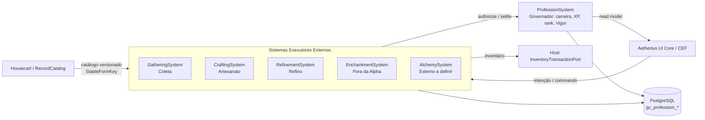

# Profissões (Coleta, Artesanato, Refino e Encantamento)

## Resumo

Ecossistema econômico e de carreira profissional documentado no `AetheriusGameplayCore`. Separa o governador da carreira (`profession-system`) dos domínios executores (`gathering-system`, `crafting-system`, `refinement-system` e `enchantment-system`), com lógica autoritativa no servidor, catálogos dinâmicos via Housecarl (`StableFormKey`) e integração com a `Aetherius UI Core`.

> [!IMPORTANT]
> **Documentação versus implementação:** os cinco módulos de profissões em `AetheriusGameplayCore/modules/` são **especificação normativa e de planejamento**. No Core existem apenas a documentação técnica e as migrations/helpers de persistência trazidos do servidor oficial no SYNC-1114 (`0013_gc_professions_uuid_v2.sql`, `0014_gc_profession_world.sql` e `professionPersistence`). O código executor atual do servidor (`server/gameplay/professions`, fora do Core) aguarda nova interface.

## Documentos deste sistema

- [Catálogo e progressão (`profession-system`)](catalogo-e-progressao.md) — governador de carreira, 5 ranks, XP, Vigor Profissional, penalidade para artesãos abaixo do rank, matriz econômica e contratos.
- [Coleta (`gathering-system`)](coleta.md) — Minerador, Herbalista, Caçador e Fazendeiro, estoques/cooldowns, carcaças, pools, ferramentas, sessões CEF e persistência.
- [Artesanato (`crafting-system`)](artesanato.md) — autorização de bancadas, isolamento de receitas, workflows tolerantes de Ferreiro e Curtidor, conversão de materiais, orçamentos de sets, kits e diretrizes visuais CEF.
- [Refino e Encantamento (`refinement-system` / `enchantment-system`)](refino-e-encantamento.md) — conceito de refino por instância (Tiers I–III), risco/regressão, relação com `damage-system` e estado do Encantamento (fora da Alpha).
- [Housecarl, Balanceamento e Persistência](housecarl-e-persistencia.md) — `StableFormKey`, política transversal de balanceamento configurável, auditoria de equipamentos e migrations `0013`/`0014`.
- [Diário de desenvolvimento](diario.md) — linha do tempo das entregas documentais e sincronizações.
- [Guia da Staff](../../07-guia-da-staff/profissoes/README.md) — explicação simples para toda a Staff.

## Onde está o código

- Repositório fonte da documentação e persistência Core: https://github.com/pablo-rodrigues1/AetheriusGameplayCore (branch `main`)
- Pastas no `AetheriusGameplayCore`:
  - `modules/profession-system/` — governador das profissões (`README.md` e `docs/`)
  - `modules/gathering-system/` — mecânicas e arquitetura de coleta (`README.md` e `docs/`)
  - `modules/crafting-system/` — artesanato, estações, balanceamento e diretrizes de UI (`README.md` e `docs/`)
  - `modules/refinement-system/` — definição conceitual do refino por instância (`README.md`)
  - `modules/enchantment-system/` — placeholder documental fora da Alpha (`README.md`)
  - `modules/durability-system/docs/KIT_RECIPES_AND_BALANCE.md` — receitas aprovadas de kits de manutenção
  - `docs/architecture/AETHERIUS_BALANCE_CONFIGURATION_POLICY.md` — política transversal de parâmetros configuráveis
  - `database/migrations/0013_gc_professions_uuid_v2.sql` e `0014_gc_profession_world.sql` — tabelas `gc_profession_*`
  - `runtime/src/index.ts` — export `professionPersistence` (`withTransaction`, `executeCommand`, `assertCharacterKey`)
- Código executor no servidor oficial (fora do Core): `aetherius-server`, pasta `server/gameplay/professions` (exposto no host via `professionApi`, omitido do build isolado do Core).

## Escopo

- **Inclui:**
  - carreira profissional única por personagem, 5 ranks (`Novato` a `Mestre`), XP profissional e Vigor Profissional;
  - coleta universal em nível `Novato` para os 4 coletores (sem XP fora da profissão selecionada);
  - especificação das 9 profissões com progressão definida (4 coletores + 5 artesãos, com Cozinheiro absorvendo Cervejeiro);
  - especificação conceitual do Encantador (fora da Alpha) e reserva do Alquimista (desbloqueios e perks em aberto);
  - workflows, receitas de conversão/sets/kits, refino por instância, integração CEF e persistência `gc_profession_*`.
- **Não inclui:**
  - implementação funcional dos módulos TS `profession-system`, `gathering-system`, `crafting-system` e `refinement-system` dentro do Core;
  - `enchantment-system` na release Alpha;
  - definição de desbloqueios/perks de `Alquimista`;
  - serviços `Guarda` e `Mensageiro` (categoria `service` reservada, fora do escopo desta rodada);
  - empresas, contratação, salários e imposto comercial (ver [COMÉRCIO](../expansao-dos-paineis/comercio-empresas-e-profissoes.md)).

## Funcionamento

## Quadro das profissões no catálogo

| Profissão | Categoria | Progressão definida | Perks vanilla | Situação no Core |
|---|---|---|---|---|
| Fazendeiro | Coletor | Sim | Não usados | Documentado (`gathering-system`) |
| Minerador | Coletor | Sim | Não usados | Documentado (`gathering-system`) |
| Caçador | Coletor | Sim | Não usados | Documentado (`gathering-system`) |
| Herbalista | Coletor | Sim | Não usados | Documentado (`gathering-system`) |
| Cozinheiro (inclui Cervejeiro) | Artesão | Sim | Não usados | Documentado (`crafting-system`) |
| Artífice | Artesão | Sim | Não usados | Documentado (`crafting-system`) |
| Ferreiro | Artesão | Sim | Não usados | Documentado (`crafting-system`) |
| Curtidor | Artesão | Sim | Não usados | Documentado (`crafting-system`) |
| Alfaiate | Artesão | Sim | Não usados | Documentado (`crafting-system`) |
| Encantador | Artesão | Conceitual | Política pendente | **Fora da release Alpha** (`enchantment-system`) |
| Alquimista | Artesão | Pendente | Política pendente | Sistema externo a definir |
| Guarda / Mensageiro | Serviço | Fora do escopo | — | Categoria `service` reservada |

## Parâmetros e fórmulas

| Parâmetro | Valor default (configurável) | Descrição |
|---|---|---|
| Profissões especializadas por personagem | 1 | Escolha persistente; coleta geral `Novato` é universal sem XP |
| Escala de ranks | `Novato → Aprendiz → Adepto → Especialista → Mestre` | Limiares sugeridos: `0 / 500 / 1.500 / 3.500 / 6.000` XP |
| Vigor Profissional | `100%` máximo; `5%` base; atraso `60 s`; regen `1%/min` | Recurso econômico próprio (não é Stamina do Skyrim) |
| Penalidade de Vigor (artesãos abaixo do rank) | `1,00x / 1,50x / 2,00x / 3,00x / 4,00x` | Para 0, 1, 2, 3 ou 4 ranks abaixo do artesão |
| Anti-powerlevel de XP | `100% / 50% / 10%` | Mesmo rank / 1 abaixo / 2+ abaixo |

## Dependências

| Depende de | Por quê |
|---|---|
| [GameplayCore](../gameplay-core/README.md) | Arquitetura canônica, `RecordCatalog`, `persistence`, `durability-system` (kits) e futura integração com `damage-system` (refino) |
| [UI Core](../ui-core/README.md) | Shell CEF, `UiTransportPort`, sessão autenticada e design tokens (sem browser paralelo) |
| `AetheriusRP/aetherius-server` | Executor atual em `server/gameplay/professions` e Host Ports (`InventoryTransactionPort`, `WorldSnapshotPort`, etc.) |
| Housecarl | Scan da load order real e resolução de `StableFormKey` / winning records |
| PostgreSQL | Tabelas `gc_profession_*` (`0013` e `0014`) |

## Decisões relacionadas

- [ADR-0002](../../03-decisoes/ADR-0002-sincronizacao-dos-cores-com-os-repositorios-oficiais.md): separação entre Core e `server/gameplay/professions` na sincronização.
- [ADR-0003](../../03-decisoes/ADR-0003-codigo-prevalece-sobre-planilhas-de-design.md): código prevalece sobre planilhas/design não implementado.
- [ADR-0005](../../03-decisoes/ADR-0005-comercio-empresas-e-profissoes.md): empresas do COMÉRCIO contratam profissionais sem conceder profissão, rank ou receitas ao titular.

## Diário

Ver [`diario.md`](diario.md).

## Pendências conhecidas

- Implementação funcional no `AetheriusGameplayCore` e integração da nova interface CEF (sistema no servidor bloqueado pela UI).
- Política de perks vanilla e desbloqueios por rank de **Alquimista**; política de perks vanilla e planejamento completo de **Encantador** (pós-Alpha).
- Especificação técnica completa do `refinement-system` e integração futura com o `damage-system`.
- Workstation oficial de **Alfaiate**, mapeamentos Housecarl da release e auditoria integral de `WEAP`/`ARMO` sem material identificado.
- Alinhamento de fim de linha (LF vs CRLF) da migration `0013_gc_professions_uuid_v2.sql` entre servidor e Core.
- Definição futura de **Guarda** e **Mensageiro** (`service`).
