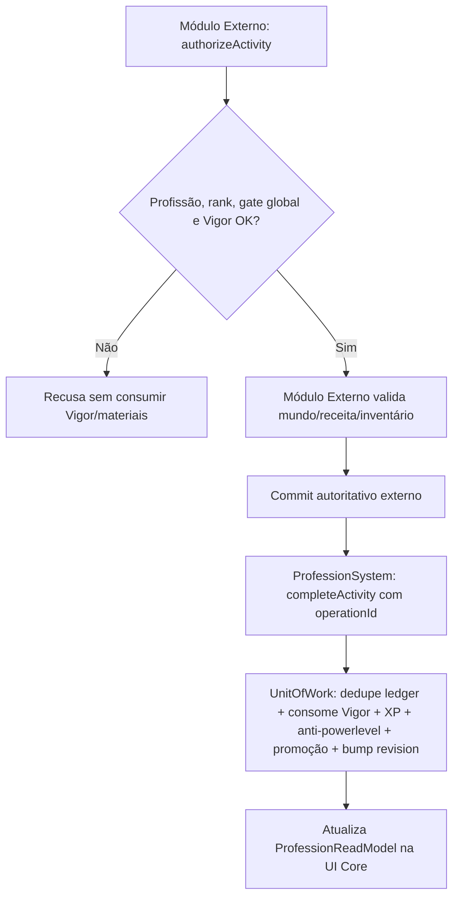

# Catálogo e Progressão das Profissões (`profession-system`)

## Resumo

Especificação do governador canônico das profissões (`profession-system`) no `AetheriusGameplayCore`: especialização única, escala de 5 ranks, XP, Vigor Profissional, penalidade econômica para artesãos abaixo do rank, matriz de dependência, progressão de cada ofício e contratos públicos com os módulos executores.

## 1. Princípios e Ownership

- **Especialização única:** cada personagem possui **somente 1 profissão especializada** persistente. Troca ou reset futuro exige comando administrativo ou regra econômica explícita, nunca escolha livre pelo cliente.
- **Coleta Novato universal:** todo personagem tem acesso básico em nível **Novato** às 4 coletas (`Minerador`, `Herbalista`, `Fazendeiro`, `Caçador`) quando atende aos requisitos físicos. Contudo, **apenas a profissão selecionada ganha XP, avança de rank e desbloqueia tiers de Aprendiz em diante**.
- **Autoridade server-side:** o cliente envia intenção; os módulos executores validam mecânicas; o `profession-system` é o único writer de `selectedProfession`, `professionXp`, `professionRank`, `professionVigor`, `lastProfessionActivityAt`, `professionProgressionRevision`, `pendingPromotion/globalRankGateState` e do ledger idempotente de atividades.

## 2. Escala de Ranks, XP e Vigor

### 2.1. Ranks e limiares de XP (configuráveis)

Escala única para todas as profissões: `Novato → Aprendiz → Adepto → Especialista → Mestre`.

| Rank | XP acumulado sugerido | XP base por atividade (multiplicador) | Anti-powerlevel (XP concedido) |
|---|---:|---|---|
| Novato | 0 | 10 (`x2.0`) | Mesmo rank: **100%** |
| Aprendiz | 500 | 12 (`x2.5`) | 1 rank abaixo: **50%** |
| Adepto | 1.500 | 15 (`x3.0`) | 2+ ranks abaixo: **10%** |
| Especialista | 3.500 | 17 (`x3.5`) | Coleta Novato fora da profissão: **0%** |
| Mestre | 6.000 | 20 (`x4.0`) | — |

XP profissional é totalmente separado de `totalXp` e `characterLevel` do `leveling-system`.

### 2.2. Vigor Profissional e penalidade por defasagem de rank

Recurso econômico separado da Stamina do Skyrim. Defaults configuráveis:

| Parâmetro | Default | Regra |
|---|---:|---|
| Máximo / Custo básico | `100%` / `5%` | Equivale a 20 ações básicas com barra cheia |
| Atraso / Taxa de regeneração | `60 s` / `1% por minuto` | Calculada por timestamp (`lastProfessionActivityAt`); bloqueada durante atividade |
| Consumo | Pós-sucesso | Atividade recusada, alvo esgotado ou falta de item não consome Vigor |

**Proteção econômica para artesãos (`artisan`):** produzir receitas com `activityRank` abaixo do rank atual do artesão consome progressivamente mais Vigor, mesmo quando XP já não importa (ex.: no rank Mestre). Não aumenta a dificuldade do minigame; Vigor insuficiente bloqueia a ação antes de reservar materiais.

| Diferença (`artisanRank - activityRank`) | Multiplicador de Vigor | Exemplo (custo-base 5%) |
|---|---:|---:|
| Mesmo rank (0) | `1,00x` | 5% (20 crafts) |
| 1 rank abaixo | `1,50x` | 7,5% |
| 2 ranks abaixo | `2,00x` | 10% |
| 3 ranks abaixo | `3,00x` | 15% |
| 4 ranks abaixo | `4,00x` | 20% (5 crafts) |

### 2.3. Gate global de Mestre

Um personagem pode atingir o XP de Mestre sem ser promovido se o tier estiver bloqueado pela staff. O estado distingue `masterImplemented`, `masterGloballyEnabled`, `masterCatalogReady` e `masterExternalCapabilityReady`, exibindo o motivo na UI.

## 3. Progressão dos Coletores

| Profissão | Ferramenta | Novato | Aprendiz | Adepto | Especialista | Mestre |
|---|---|---|---|---|---|---|
| **Fazendeiro** | Enxada (`Hoe`) | 1 item aleatório | 2 itens aleatórios | 3 itens aleatórios | 3 rolls (10% duplicar cada) | 3 rolls (20% duplicar cada) |
| **Minerador** | Picareta | Ferro (`1 Iron Ore + 1 Coal`) | +1% gema comum | Libera Corundum e Silver; 2% gema comum | Libera Gold; 3% gema comum | Orichalcum, Quicksilver, Dwemer controlado; 20% duplicar; 1% gema perfeita (gate bloqueável) |
| **Caçador** | Nenhuma adicional | 1 carne da espécie | +1 pele/hide | +1 ingrediente alquímico | 2 unidades de cada categoria liberada | Mantém Especialista + 20% duplicar |
| **Herbalista** | Bolsa (`Satchel`) | 1 recurso-base | 2 recurso-base | +10% ingrediente alquímico aleatório (pool total autorizada) | +20% ingrediente aleatório | Mantém + 20% duplicar resultado |

## 4. Progressão dos Artesãos

| Profissão | Novato | Aprendiz | Adepto | Especialista | Mestre |
|---|---|---|---|---|---|
| **Cozinheiro** *(inclui ex-Cervejeiro)* | Refeições simples / carnes grelhadas; fermentados simples | Ensopados de vegetais; vinhos e hidroméis elaborados | Ensopados de carne; destilados e bebidas especiais | Demais receitas; bebidas premium/envelhecidas; 20% preservar ingrediente comum | Receitas raras e **Skooma ilegal** *(sem bônus de preservação/duplicação)*; 20% duplicar output |
| **Artífice** | Enxadas, Lanternas, Tochas, Bandanas/Máscaras, Bolsas/Satchels | Mochilas, Anéis, Utensílios, Soul Gems preenchidas Petty/Lesser | Colares, Amuletos, Brasões/Insígnias, Soul Gems Common/Greater | Tiaras, Soul Gems Grand | 20% preservar um ingrediente |
| **Ferreiro** | Armas/equip./flechas de Ferro, Picaretas, Kit de Ferro | Heavy Armor de guildas *(membership)*; 10% preservar material | Armas/equip./flechas de Aço + Kit de Aço | Armas/equip. Steel Plate + Kit Steel Plate *(teto regular)* | Culturais Nordic, Dwemer, Orcish + kits *(gate bloqueável)* |
| **Curtidor** | Equip. Pele de Animal + Kit correspondente | Light Armor de guildas *(membership)*; 10% preservar material | Equip. de Couro + Kit de Couro | Equip./flechas Élficas + Kit Élfico | Culturais Nordic, Dwemer, Orcish conforme mapping |
| **Alfaiate** | Roupas simples vanilla | Capas, acessórios de pele, capuzes, roupas de guilda *(membership)* | Roupas elaboradas / nobres aplicáveis | Roupas nobres avançadas | 20% preservar um material |
| **Encantador** *(fora da Alpha)* | Armas/equip. Ferro e Pele; Anéis | Aço e Couro; Colares e Amuletos | Élficos e Steel Plate; Tiaras | Dwemer, Nordic, Orcish | Ébano e Stalhrim *(se existir fonte autorizada)*; Grand White → Black Soul Gem *(ilegal)* |
| **Alquimista** | *Pendente* | *Pendente* | *Pendente* | *Pendente* | *Pendente (aguarda definição do sistema externo)* |

> [!NOTE]
> **Serviços:** `Guarda` e `Mensageiro` têm a categoria `service` reservada no governador, mas estão fora do escopo desta rodada documental.

## 5. Matriz de dependência econômica e Perks Vanilla

| Coletor | Profissões alimentadas (design econômico) |
|---|---|
| Fazendeiro | Cozinheiro, Alfaiate |
| Caçador | Cozinheiro, Alfaiate, Curtidor, Alquimista |
| Herbalista | Alquimista, Cozinheiro |
| Minerador | Ferreiro, Curtidor, Artífice, Cozinheiro |

- **Perks vanilla:** com exceção de **Alquimista** e **Encantador** (política em aberto), **nenhuma profissão usa perks vanilla** de Smithing, Light Armor ou outras árvores para autorizar crafting, refino, workstation, yields ou progressão.
- **Guildas:** receitas de guilda consultam o owner de membership por contrato; o `profession-system` fornece apenas o rank.

## 6. Contratos públicos e Fluxo de Liquidação

Módulos externos consomem um port (`ProfessionGovernorPort`) com `authorizeActivity(input)`, `settleCompletedActivity(input)` e `getProfessionState(actorKey)`. Nunca escrevem diretamente em XP/rank/Vigor.

**IDs canônicos de profissão (`ProfessionId`):** `alchemist`, `blacksmith`, `cook`, `enchanter`, `tanner`, `tailor`, `artificer`, `miner`, `herbalist`, `farmer`, `hunter` (`brewer` foi removido e absorvido em `cook`).
