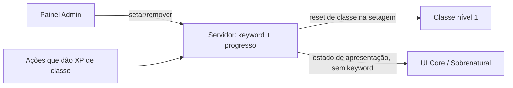

# Sobrenatural (Maldições e Pragas)

## Resumo
Três maldições externas a Classe e Profissão: Vampirismo, Licantropia e Bruxaria. Só a staff concede uma maldição, pelo Painel Administrativo. O jogador evolui por 6 estágios de XP de maldição (2.000.000 XP no total), e tudo aparece no módulo **Sobrenatural** do UI Core.

## Onde está o código
- Desenvolvimento local em `C:\Code\Aetherius - New Systems\Sobrenatural` (`AGENTS.md` e `RETOMADA.md` na pasta do projeto). Ainda não há repositório próprio; tudo será compilado em uma pasta final.
- Lobisomem: construído **a partir do pacote de kdu** ([Lobisomem sincronizado](../lobisomem/README.md)), que é dono da forma da fera.
- UI Core: módulo `supernatural` (rota `/supernatural`, slot radial 8) já presente no catálogo de navegação.

## Escopo
- Inclui: setagem/remoção pelo painel; keyword permanente só no servidor (`JogadorVampiro`, `JogadorLobisomem`, `JogadorBruxa`); reset de classe na setagem; XP e 6 estágios; Disciplinas (vampiro) e Vertentes (bruxa); atributos, perks e poderes por estágio; as 4 telas da UI.
- Não inclui: animação, sincronização e efeitos da transformação em fera (sistema [lobisomem](../lobisomem/README.md)); permadeath (decisão de RP da staff).

## Funcionamento

- A keyword nunca chega ao cliente. A remoção apaga todo o progresso da maldição.
- A UI tem 4 telas: sem praga ("Você não é portador de nenhuma praga."), Vampiro, Lobisomem e Bruxa.

## Parâmetros e fórmulas
| Estágio | Custo | XP acumulada |
|---|---|---|
| 1 | — | 0 |
| 2 | 20.000 | 20.000 |
| 3 | 40.000 | 60.000 |
| 4 | 130.000 | 190.000 |
| 5 | 420.000 | 610.000 |
| 6 | 1.390.000 | 2.000.000 |

Nível da Disciplina do vampiro = estágio − 1. Detalhes completos em [especificacao.md](especificacao.md).

## Decisões
Todas as decisões de funcionamento estão em [decisoes.md](decisoes.md); o que falta, em [pendencias.md](pendencias.md); como retomar, em [retomada.md](retomada.md).

## Pendências
- Aprovar os textos de Lobisomem e Bruxa ([proposta-textos.md](proposta-textos.md)).
- ~~Vertente/troca~~: Vertente no estágio 1; nenhuma troca; 2ª Disciplina no Apoteótico.
- Etapa 1 concluída; Etapa 2 com painel F7 e serviços locais. [Formas e poderes](formas-e-poderes.md): lote menor 4fc0034 (Fera/Lorde/raça/recarga) pronto para reteste; revisão de retorno e jogo pendentes, demais poderes adiados. Névoa/Força parciais sem nativo por decisão do dev ([ADR-0015](../../03-decisoes/ADR-0015-sobrenatural-lotes-js.md)). Nenhuma homologação oficial.

## Candidato local de 16/11
Origem de grants, integração Bruxaria e poderes JS foram implementados com 122 testes e builds sem addon. [Relatório e roteiro](formas-e-poderes.md), [Bruxaria](etapa-2-bruxaria.md) e [ADR-0019](../../03-decisoes/ADR-0019-sobrenatural-origem-e-tempos.md). Revisão Terra e teste humano pendentes; não aplicado ao oficial.

## Transformação forçada — candidato de 16/11
[Relatório e roteiro](etapa-2-transformacao-forcada.md): 72 h reais online, janela 20h–5h, aviso privado de 20 s e animação pública normal kdu; atalho F7 no alvo. 122 testes Node e scripts serviço/F7 passaram, runtime preparado com servidor parado. Revisão independente e jogo pendentes; [ADR-0020](../../03-decisoes/ADR-0020-sobrenatural-transformacao-forcada.md). O contador e a obrigação de transformar pertencem ao Sobrenatural; o serviço kdu conserva o domínio da forma/animação.
