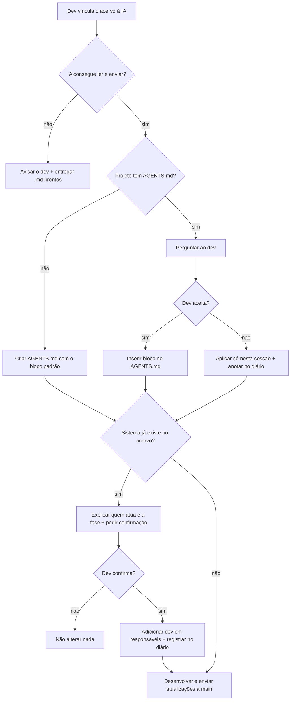

# Integração das IAs com o acervo

## Resumo
Como a IA de cada dev se conecta ao acervo, instala a regra de envio no projeto e mantém a documentação atualizada a cada etapa.

## Fluxo


## Bloco padrão para o AGENTS.md do projeto

Copie exatamente (os marcadores permitem atualizar o bloco no futuro):

```markdown
<!-- ACERVO-AETHERIUS:INICIO -->
## Documentação obrigatória: Acervo Aetherius
Este projeto documenta seu desenvolvimento em:
https://github.com/pablo-rodrigues1/AETHERIUS-ACERVO-DE-INFORMACOES

Regras (completas em REGRAS.md do acervo, seção 10):
1. Antes de criar ou alterar um sistema, leia INDICE.md, o sistema afetado, seus dependentes e os ADRs vigentes no acervo.
2. Envie atualizações continuamente por commit direto na `main` do acervo (`git pull --rebase` antes; mensagem `docs(<sistema>): <resumo>`):
   no início do sistema, a cada decisão relevante, mudança de fórmula/parâmetro, entrega, bloqueio e ao fim de cada sessão.
3. Atualize: `02-sistemas/<sistema>/diario.md`, o quadro de status em `02-sistemas/README.md` e, quando couber, README do sistema, ADRs, CHANGELOG e INDICE.
4. Apenas arquivos .md, seguindo os modelos de `_modelos/`.
5. Se este repositório for isolado, garanta que o sistema no acervo tenha `repositorio: <URL deste repo>` e mantenha aqui um link de volta para a documentação.
6. Se o sistema já existir no acervo, explique ao dev quem atua nele e em que fase está, e peça confirmação antes de continuar.
7. Se não conseguir ler ou enviar ao acervo, AVISE O DEV imediatamente e entregue os .md prontos.
8. Nunca envie segredos, IPs de produção ou dados de jogadores.
<!-- ACERVO-AETHERIUS:FIM -->
```

## Mensagens padrão da IA
- **AGENTS.md existente:** "Seu projeto já tem um AGENTS.md. Posso inserir nele as instruções de envio ao Acervo Aetherius? (bloco entre marcadores ACERVO-AETHERIUS)"
- **Sistema já existente:** "O sistema <nome> já está no acervo, sob responsabilidade de <responsáveis> (fase: <fase>, última atualização: <data>). Deseja continuar mesmo assim, sabendo que outra pessoa está atuando nele?"
- **Falha de acesso:** "Não consegui <ler/enviar> ao Acervo Aetherius: <erro>. Preparei os arquivos abaixo para você enviar manualmente."
